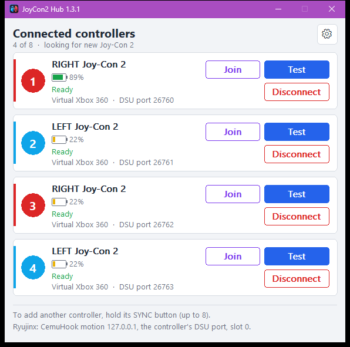
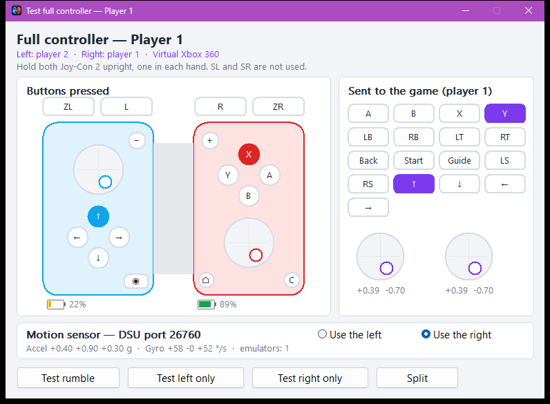
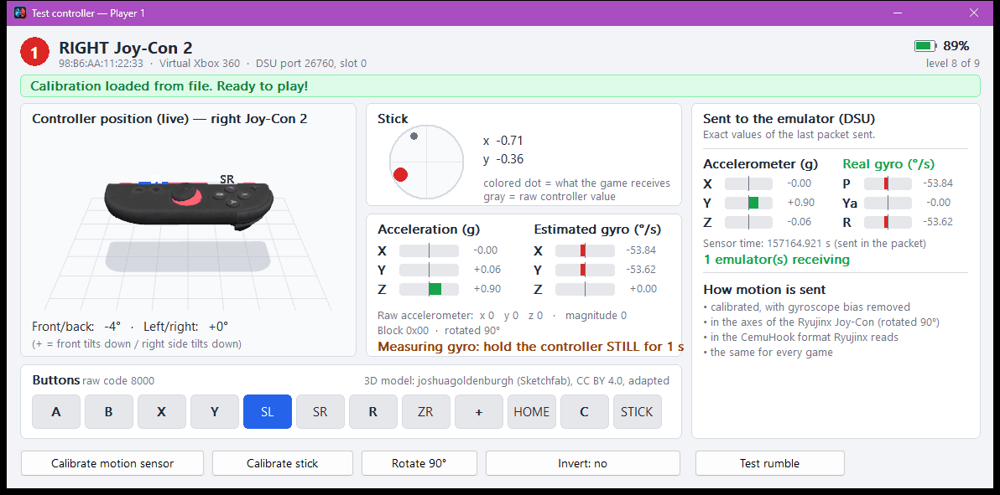

# JoyCon2 Hub — Use Joy-Con 2 on PC (Windows)

🇺🇸 **English** · 🇧🇷 [Português](README.pt-BR.md) · ☕ [Support the project](#-support-the-project)

**Use your Nintendo Switch 2 Joy-Con 2 controllers on a Windows PC and in Ryujinx — every button including SL/SR, sticks, HD rumble and motion (real gyro).**

JoyCon2 Hub connects up to **8 Joy-Con 2** over Bluetooth, enables all of their features (including the **SL** and **SR** buttons, which normally don't work on PC) and turns each one into a **virtual controller** that any game or emulator recognizes. Motion is sent over the **CemuHook (DSU)** protocol, used by Ryujinx, Cemu, Dolphin and others. No Windows pairing needed — just hold SYNC.

> ⬇️ **[Download the latest version](../../releases/latest)** — file `JoyCon2Hub_Setup_x.y.z.exe`

<p align="center">
  
  &nbsp;
  
</p>
<p align="center">
  
</p>

## Features

- **Up to 8 Joy-Con 2 at the same time**, each one as a separate player (left or right, detected automatically).
- **Every button**, including **SL/SR**, HOME, Capture and the **C** button of the right Joy-Con 2.
- **One virtual controller per player**: Xbox 360 for players 1–4 and DualShock 4 for players 5–8.
- **Join left + right into one full controller**: the **Join** button on a Joy-Con's card pairs it with one from the other side (if more than one is available, you pick which). Both become **a single virtual controller**, held upright like a regular gamepad: two sticks, d-pad, ABXY, L/R, ZL/ZR, −/+ and HOME (SL/SR are not used). Motion goes out on the main player's DSU port and slot, and you choose whether it comes from the **left or right** Joy-Con. The joined card has **Test** (its own full-controller window), **Split** and **Disconnect** (both). When they connect, Joy-Cons always start as separate controllers.
- **Motion (CemuHook/DSU)**: a single server with **one slot per controller**: port `26760`, slot = player number − 1 (players 1–4 on slots 0–3; players 5–8 on port `26761`, slots 0–3). Each controller's card shows its port and slot.
- **Game rumble** forwarded to the Joy-Con (HD rumble).
- **Player LED** lit according to the player number.
- **Battery percentage** for each controller.
- **Guided calibration**: the motion sensor in 6 positions, with a 3D example of how to hold it, and the stick. Saved per controller (by MAC address).
- **Test window** with the Joy-Con in 3D moving along with the real controller, the stick, the sensors and the buttons lighting up.
- **Tray icon** and **settings in the gear menu**: start with Windows (optionally hidden in the tray) and keep running when the window is closed.
- **Automatic updates**: on startup the app tells you when a new version is out and updates itself, keeping your calibrations.
- The interface follows your Windows language (English, Português, Español, Français, Deutsch, Italiano, Русский, 日本語, 한국어, 中文).

## Requirements

- Windows 10 (1809) or Windows 11, 64-bit.
- Bluetooth with **Bluetooth LE** support (Bluetooth 4.0 or newer).
- Joy-Con 2 (Nintendo Switch 2).
- The **ViGEmBus** driver, which the installer sets up if it isn't on your PC yet.

## Installation

1. Download `JoyCon2Hub_Setup_x.y.z.exe` from the **[Releases](../../releases/latest)** page.
2. Run the installer.
   - The installer is not code-signed, so Windows may show **"Windows protected your PC"**. Click **More info → Run anyway**.
3. If ViGEmBus isn't installed yet, its installer opens halfway through: just follow its screens.
4. At the end, tick the option to **open JoyCon2 Hub now**.

**Updating:** just run the installer of a newer version (or accept the update prompt in the app). It installs over the old one and **keeps calibrations, settings and shortcuts**.

## How to use

### 1. Connect the Joy-Con 2
1. Open **JoyCon2 Hub**.
2. **Hold the SYNC button** on the Joy-Con 2 (the small button on the rail) until the lights start running.
3. The controller shows up in the list as **Player 1, 2, …**, identified as **left** or **right**. The player LED lights up on the controller.

To connect another controller, repeat with it. Each controller takes the first free spot.

### 2. Calibration (only the first time for each controller)
The first time a controller connects, the **Test controller** window opens and guides the calibration:

- **Motion sensor, in 6 positions:** lying flat with the buttons up, upside down, standing on each end, and standing with the rail down and up. Use a table and keep the controller **still** in each position; the 3D view shows how to place it.
- **Stick:** let go of the stick, then push it up and to the right when the app asks.

The calibration is saved and used automatically from then on. To redo it, open **Test** and use **Calibrate motion sensor** or **Calibrate stick**.

### 3. Set up Ryujinx
For each player, in **Options → Settings → Input**:

1. **Input device:** pick that player's Xbox 360 controller (or DualShock 4, for players 5–8).
2. **Controller type:** Left Joy-Con, Right Joy-Con or Pro Controller, depending on the game.
3. Under **Motion**, tick **"Use CemuHook compatible motion"** and fill in:
   - **Server:** `127.0.0.1`
   - **Port:** `26760` (players 5–8: `26761`).
   - **Slot:** the controller's slot, shown on its card (*DSU 26760, slot N*): player 1 = `0`, player 2 = `1`, player 3 = `2`, player 4 = `3`. Players 5–8 = slots `0`–`3` on port `26761`.
4. Save.

| Player | Port | Slot |
|---|---|---|
| 1 | 26760 | 0 |
| 2 | 26760 | 1 |
| 3 | 26760 | 2 |
| 4 | 26760 | 3 |
| 5 – 8 | 26761 | 0 – 3 |

> **Coming from version 1.3 or older?** It used to be one port per controller (26760, 26761, 26762…), always on slot 0. Now player 2 is on `26760` **slot 1**, player 3 on `26760` **slot 2**, and so on: update each player's port and slot in your emulator.

The same DSU server works in **Cemu**, **Dolphin** and other CemuHook-compatible programs.

### 3b. Set up Lichii (Switch 2 emulator) — and Eden / Eden-NX2
Lichii only connects the Switch 2 **Pro Controller** by itself. The **Joy-Con 2** come in through JoyCon2 Hub. Only download Lichii from its official GitHub releases page ([zortos293/Lichii](https://github.com/zortos293/Lichii/releases)).

1. Open **Emulation → Configure… → Controls**.
2. **Motion servers:** under **Motion**, click **Configure** (the *Configure Motion / Touch* window). In **CemuhookUDP Config**, the server `127.0.0.1` port `26760` is already there and serves players 1–4 (one slot each). Only for players 5–8, use **Add Server** with `127.0.0.1` port `26761`. The **Test** button checks the connection.
3. In each **Player N**:
   - **Input Device:** that player's Xbox 360 (or DualShock 4) controller;
   - **Controller type:** Pro Controller, Left Joycon, Right Joycon or Dual Joycons (for a pair joined with **Join**), depending on the game;
   - **Motion:** with **Right Joycon** the field is **Motion 2**. With Left Joycon or Pro Controller it's **Motion 1**. With Dual Joycons, fill in both. Click the field, **let go of the mouse** and **shake** that player's Joy-Con hard. The field stops showing *[not set]*.
     - If it shows **Mouse**, Lichii recorded the mouse, which moved before the Joy-Con. Right-click the field, choose **Clear** and try again without touching the mouse.
4. Click **OK**.

**If it still won't record:** close Lichii and edit `%APPDATA%\lichii\config\qt-config.ini`. Replace the `player_0_motionleft=` and `player_0_motionright=` lines with (player 1, port 26760):
```
player_0_motionleft="engine:cemuhookudp,motion:0,port:26760,pad:0,guid:0000000000000000000000007f000001"
player_0_motionright="engine:cemuhookudp,motion:0,port:26760,pad:0,guid:0000000000000000000000007f000001"
```
For player 2, use `player_1_…` with `port:26760` and `pad:1`. For player 3, `player_2_…` with `pad:2`; player 4, `player_3_…` with `pad:3` (`pad` is the slot). Players 5–8 use `port:26761` with `pad:4` to `pad:7` (second server in the list, slots 0–3).

Eden and Eden-NX2 have the same screens (they all come from yuzu).

### 4. "Test controller" window
Click **Test** on a controller's card to see:
- the Joy-Con in **3D** following its real position;
- the **stick**, with the value sent to the game and the raw value;
- the **acceleration** and the **gyro**;
- the **buttons** lighting up, including SL/SR.

Window buttons:
- **Calibrate motion sensor** and **Calibrate stick**.
- **Rotate 90°** and **Invert**: fine-tuning if motion in the game is rotated or mirrored.

## About motion

JoyCon2 Hub sends the Joy-Con 2's **accelerometer** and **real gyroscope** to the emulator, on all three axes:
- The gyro comes from the orientation the controller computes with its own gyroscope. That's why turning the controller flat on a table, like a flat steering wheel, also works.
- The gyroscope has a small drift that varies from controller to controller. When it connects, keep the controller **still for 1 second** so the app can measure and remove it. Meanwhile the test window shows that it's measuring the gyro.
- Until the drift is measured, the gyro is estimated from the tilt (gravity), as in older versions.

## Where the files are

| What | Where |
|---|---|
| Program | `C:\Program Files\JoyCon2 Hub\` |
| Calibrations (one per controller) | `%LOCALAPPDATA%\JoyCon2 Hub\Calibracoes\` |
| Log | `%LOCALAPPDATA%\JoyCon2 Hub\joycon2hub_log.txt` |

In the Start menu, the calibration folder shortcut opens that folder. To recalibrate a controller from scratch, delete its file.

## Troubleshooting

- **The controller doesn't show up:** hold SYNC until the lights run. Also check that the PC's Bluetooth is on. You don't need to pair it in Windows settings.
- **No Xbox controller in Ryujinx:** ViGEmBus isn't installed. Reinstall JoyCon2 Hub, which offers to install the driver.
- **Motion rotated or mirrored in the game:** use **Rotate 90°** and **Invert** in the test window.
- **Motion is off:** redo the sensor calibration, keeping the controller completely still in each position.
- **A single Joy-Con's buttons are wrong in Ryujinx (e.g. the d-pad acts as ABXY):** check that player's CemuHook **port and slot** in Ryujinx. The app reads them to know whether Ryujinx expects a Left/Right Joy-Con.
- If the problem persists, open an **[Issue](../../issues)** and attach `joycon2hub_log.txt`.

## ☕ Support the project

JoyCon2 Hub is free. If it's useful to you, you can support its development with a crypto donation from any wallet or exchange:

<p>
  
</p>

**USDT — BNB Smart Chain (BEP20)**
```
0x1267f05b70d729e258e2C1c3f02e7F2Be8127190
```

> ⚠️ Send **only USDT on the BNB Smart Chain (BEP20)** network to this address. Other coins or networks may be lost.

Thank you! Sharing the project, starring the repo ⭐ and reporting bugs also helps a lot.

<br clear="right">

## Credits and licenses

- Right Joy-Con 2 3D model: **"Nintendo Switch Joy-Con 2 R"** by *joshuagoldenburgh* (Sketchfab), [CC BY 4.0](http://creativecommons.org/licenses/by/4.0/). Adapted: colors and parts that light up.
- Left Joy-Con 2 3D model: **"Nintendo Switch 2"** by *Nicolas Pinilla* (Sketchfab), [CC BY 4.0](http://creativecommons.org/licenses/by/4.0/). Adapted: left Joy-Con only, reoriented.
- **ViGEmBus** and **ViGEmClient** by Nefarius Software Solutions / Benjamin Höglinger-Stelzer (BSD-3 and MIT licenses).
- Installer built with **Inno Setup**.

JoyCon2 Hub's source code is not published in this repository: it holds the documentation and the installers (Releases).

*Nintendo Switch, Nintendo Switch 2 and Joy-Con are trademarks of Nintendo. This project is not affiliated with or endorsed by Nintendo.*
